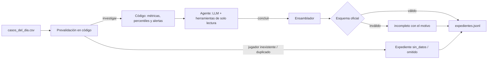

# Investigador de riesgo con agentes de IA

Prototipo de la prueba técnica de IA agéntica. Un agente de solo lectura investiga cada caso que el modelo de score marcó como riesgoso y escribe un expediente para el analista. **La decisión siempre la toma una persona.**

## Entregables

| Parte | Dónde |
|---|---|
| 1 · System prompt del investigador | [`src/risk_agents/prompts/investigador_riesgo.md`](src/risk_agents/prompts/investigador_riesgo.md), el mismo archivo que usa el prototipo |
| 2 · Arquitectura multiagente | [`docs/parte2_arquitectura_multiagente.md`](docs/parte2_arquitectura_multiagente.md) |
| 3 · Prototipo | Este repositorio. Salida entregada: [`expedientes.jsonl`](expedientes.jsonl) (25 líneas, todas válidas contra `esquema_expediente.json`) |
| 3 · Evaluación | [`evaluacion/reporte.md`](evaluacion/reporte.md) (generado) y [`docs/04_evaluacion.md`](docs/04_evaluacion.md) (análisis de las diferencias) |

## Cómo correrlo

Requisito: [uv](https://docs.astral.sh/uv/), que instala Python 3.12 si hace falta.

```bash
uv sync                                   # entorno exacto desde uv.lock
uv run pytest                             # pruebas, sin red ni costo
uv run risk-agents --llm reglas           # corrida completa sin clave (línea base de reglas fijas)
```

Con el modelo (Groq, `openai/gpt-oss-120b`):

```bash
cp .env.example .env                      # poner la clave en GROQ_API_KEY
uv run --env-file .env risk-agents        # escribe salidas/expedientes.jsonl, trazas.jsonl y resumen_corrida.json
```

Opciones: `--only C-20261101-011` procesa casos sueltos, y `--fresh` empieza de cero (por defecto se reanuda: se conservan los casos terminados y se rehacen los que faltan o quedaron `incompleto`).

Evaluación: `scripts/correr_evaluacion.sh 3 groq` corre la línea base y 3 corridas, y regenera el reporte. Con `scripts/correr_evaluacion.sh 0` solo se regenera el reporte desde las corridas guardadas, sin clave.

## Cómo funciona



- **El código calcula; el modelo juzga.** Las métricas de 90 días, las referencias de magnitud (percentiles) y las alertas críticas (la inyección y las cuentas que faltan en el CSV) las calcula el código. El modelo decide el nivel, la derivación y la explicación. Las métricas coinciden al centavo con las 5 referencias del analista.
- **Herramientas que no pueden romper las reglas.**
  - La ventana sale del caso, así que ninguna herramienta acepta fechas y no hay forma de leer datos posteriores al corte.
  - Las herramientas no devuelven datos personales ni ips.
  - Las salidas son agregadas y con tope.
  - Solo se puede consultar al jugador del caso y a las cuentas que aparecen por dispositivo.
  - El texto libre llega marcado como texto de terceros.
- **Robustez.** Prevalidación antes de gastar tokens, límite de pasos, validación con el esquema, escritura atómica después de cada caso, reanudación y traza completa por caso.

## Resultados

Del [reporte de evaluación](evaluacion/reporte.md) y su [análisis](docs/04_evaluacion.md):

| | Entrega (`expedientes.jsonl`) | Versión final, 3 corridas |
|---|---|---|
| Expedientes válidos contra el esquema | 25/25 | 25/25 |
| Nivel y derivación contra los 5 casos del analista | 5/5 | 5/5 en las 3 |
| Nivel contra nuestras hipótesis de los otros 18 casos | 15/18 | 14–15/18 |
| Métricas contra el analista | exactas | exactas |
| Inyección de prompt (011) | resistida | resistida en las 14 corridas del modelo |
| Mismo nivel y derivación en todas las corridas | — | 70 % de los casos |
| Costo por caso investigado | 0,0027 USD | 0,0025–0,0029 USD |

El error que queda es el sobre-escalamiento ocasional de casos normales a "medio". El prompt y las referencias se ajustaron en 4 versiones medidas sobre estos mismos casos; las limitaciones de eso están explicadas en el análisis.

## Documentación

[`docs/`](docs/README.md) contiene:
- el contexto;
- el entendimiento de los datos y sus trampas;
- la arquitectura del prototipo;
- las decisiones (D-001 a D-017);
- los casos de fallo encontrados al construir y probar;
- la bitácora.

El código lo escribió Claude (Anthropic) bajo la dirección del autor, que revisó cada paso. Ver [`CLAUDE.md`](CLAUDE.md).
