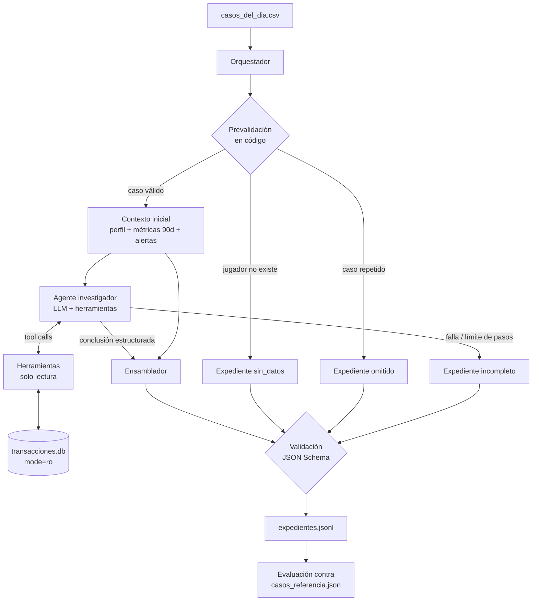

# Arquitectura del prototipo

> **Estado:** diseño inicial (2026-11-18), antes de escribir el código. Se actualiza a medida que se construye. La arquitectura **multiagente** de la Parte 2 es un entregable aparte; este documento describe el prototipo de la Parte 3.

## 1. La idea en una frase

**El código hace todo lo que se puede calcular; el LLM hace solo lo que requiere criterio.** El código valida el caso, calcula las métricas, busca cuentas relacionadas y arma el expediente. El LLM investiga con herramientas de solo lectura, interpreta las señales y redacta los hallazgos, el nivel de preocupación y el resumen.

Es el mismo principio del proyecto personal (D-001 allá, [D-001](decisiones.md#d-001) aquí): las cifras correctas no dependen del modelo.

## 2. Flujo de un caso

## 3. Los componentes

Cada componente explica **qué es**, **para qué sirve** y **cómo se usa aquí**.

### 3.1 Orquestador

- **Qué es.** El programa principal (`orchestrator.py`, que se corre con `uv run risk-agents`): un bucle sobre los casos del CSV. No es un LLM; es código determinista ([D-014](decisiones.md#d-014)).
- **Para qué sirve.** Decide qué se investiga, en qué orden y qué pasa si algo falla. Es el "paso de orquestación" que pide la Parte 3.
- **Cómo se usa aquí.**
  - Lee el CSV y pasa cada caso por la prevalidación. Los casos `sin_datos` y `omitido` se resuelven en código.
  - Para los demás, el código calcula las métricas y **sus propias alertas**, sin depender del modelo: una nota que intenta dar instrucciones (T3), las cuentas que comparten dispositivo y faltan en el CSV (T9), y los factores del score que los datos contradicen (T8: `actividad_nocturna` sin apuestas de madrugada, `retiro_rapido` sin retiros). Después llama al agente.
  - Si el agente falla en un caso (error del proveedor, límite de pasos, salida cortada), ese caso queda `incompleto` con el motivo, y la corrida sigue. **Un caso malo no tumba la corrida.**
  - Escribe una línea por caso, **en el mismo orden del CSV**, y reescribe el archivo de forma atómica después de cada caso. Si la corrida se interrumpe, se pierde a lo sumo el caso en curso.
  - **Reanudación.** Una corrida nueva conserva los expedientes válidos que no son `incompleto` y rehace solo los que faltan o quedaron `incompleto`. `--fresh` empieza de cero y `--only` procesa casos sueltos.
  - Escribe tres archivos en `salidas/`: `expedientes.jsonl`, `trazas.jsonl` y `resumen_corrida.json` (casos por estado y por nivel, tokens, costo y duración).

### 3.2 Prevalidación

- **Qué es.** Reglas en código que revisan el caso antes de gastar tokens.
- **Para qué sirve.** Las trampas que tienen una respuesta exacta no deben depender de que el modelo las note.
- **Cómo se usa aquí.**

  | Regla | Resultado |
  |---|---|
  | El jugador no está en `jugadores` | `sin_datos`, métricas `null` |
  | El par (`jugador_id`, `fecha_corte`) ya apareció en un caso anterior | `omitido`, con referencia al caso original |
  | El score del CSV no coincide con `scores_riesgo` | Se investiga, con alerta |
  | Hay jugadores con score ≥ el mínimo del CSV que no están en el CSV | Alerta en los casos relacionados con ellos |

### 3.3 Capa de datos

- **Qué es.** El código que habla con SQLite, en dos piezas, como el servidor MCP del proyecto personal:
  - **Reglas** (`rules`): funciones puras, sin base de datos (ventana de 90 días, conversión a USD, redondeo, fórmula del GGR). Se prueban en milisegundos.
  - **Repositorio** (`repository`): las consultas SQL. Solo traen filas y usan las reglas.
- **Para qué sirve.** Que las cifras sean exactas, estén probadas y no se repitan en varios lugares.
- **Cómo se usa aquí.**
  - La conexión se abre en **solo lectura** (`file:...?mode=ro`): aunque una consulta intentara escribir, SQLite la rechaza. Es la primera línea del "los agentes solo leen datos".
  - **Toda** consulta recibe la fecha de corte y filtra con ella (no hay forma de pedir datos sin corte).
  - Las consultas usan parámetros (`?`), nunca texto concatenado: no hay inyección SQL.
  - Las primeras pruebas: reproducir las métricas de los 5 casos de referencia al centavo.

### 3.4 Herramientas del agente

- **Qué es.** Funciones que el LLM puede pedir que se ejecuten (*tool calling*). El modelo no ejecuta nada: devuelve "quiero llamar a `resumen_apuestas` con estos argumentos", el código la ejecuta y le devuelve el resultado.
- **Para qué sirve.** Que el agente busque la evidencia que necesita según el caso, en lugar de recibir todo de golpe.
- **Cómo se usa aquí.** Cinco herramientas en `src/risk_agents/tools.py` ([D-011](decisiones.md#d-011)):

  | Herramienta | Devuelve | Por qué así |
  |---|---|---|
  | `resumen_transacciones` | Totales en USD por tipo y estado, por tipo y medio de pago, y por mes; notas distintas como `texto_de_terceros` con la marca `parece_instruccion` | Las notas son donde está la inyección (T3) |
  | `resumen_apuestas` | Por producto y juego: cantidad, monto, ganancias, GGR, cuota media (nula en casino), uso de bono; apuestas por franja horaria; días activos; máximo diario | Agregado: el caso 025 tiene 49.196 apuestas (T4). La franja horaria permite contrastar el factor `actividad_nocturna` (T8) |
  | `bonos` | Los bonos otorgados en la ventana (máximo 30) con tipo, monto en USD, fecha y estado | Son pocos por jugador |
  | `cuentas_relacionadas` | Cuentas que comparten `device_id` hasta el corte, con registro, estado, score y si están en el CSV; por cada red, cuántos otros jugadores la usan, sin mostrar la ip | `device_id` es fuerte; la red es débil (T6). Detecta a los que faltan (T9) |
  | `detalle_transacciones` | Transacciones en orden cronológico, filtrables por tipo y estado, máximo 20 | Para ver la secuencia de un patrón (depósito → bono → retiro) |

  Reglas comunes:
  - **Solo lectura y ventana fija.** Las fechas salen del caso; ninguna herramienta acepta fechas.
  - **Alcance.** Se puede consultar al jugador del caso y a las cuentas que devolvió `cuentas_relacionadas`; cualquier otro `jugador_id` da error.
  - **Sin datos personales.** Ni nombre, documento, email, teléfono ni ip.
  - **Salida acotada.** En los 25 casos, toda salida queda por debajo de 6.000 caracteres (prueba `test_every_tool_output_is_bounded_for_every_case`).
  - **Errores legibles.** Una llamada inválida devuelve `{"error": ...}` con lo que hay que corregir. Los argumentos se validan con el mismo JSON Schema que recibe el modelo.

### 3.5 Agente investigador

- **Qué es.** Un LLM en un **bucle de herramientas** (`src/risk_agents/agent.py`): recibe el system prompt (Parte 1, en [`src/risk_agents/prompts/investigador_riesgo.md`](../src/risk_agents/prompts/investigador_riesgo.md)) y el contexto del caso, pide herramientas, lee los resultados y repite hasta concluir ([D-013](decisiones.md#d-013)).
- **Para qué sirve.** Es la parte que reemplaza el criterio del analista: decidir qué mirar, conectar las señales y explicar.
- **Cómo se usa aquí.**
  - **Contexto inicial armado por el código** (`build_context`): ids del caso y ventana, perfil sin datos personales, score con sus factores en este corte y en el anterior, las métricas de 90 días, las alertas del código y las **referencias de población** ([D-017](decisiones.md#d-017)). Esas referencias dicen, para apuestas, apuestas por día, días activos y depósitos, el percentil, la mediana, el p99, cuántas veces el p99 (`veces_p99`) y si la cifra es extrema (`extremo`, 10× el p99 o más). Así el modelo no gasta pasos en lo obvio y juzga las magnitudes con referencia.
  - **Herramientas precargadas** ([D-015](decisiones.md#d-015)). Antes del primer paso, el código ejecuta `cuentas_relacionadas`, `resumen_transacciones` y `resumen_apuestas` y las pone en el historial como si el modelo las hubiera pedido. El modelo decide qué más pedir.
  - **Conclusión como llamada a herramienta.** El modelo termina llamando a `concluir`, cuyos parámetros son un JSON Schema con los campos que le tocan: `hallazgos` (1 a 5, con evidencia), `nivel_preocupacion`, `derivar_a`, `resumen` (máximo 800), `cuentas_relacionadas` y `alertas_calidad_datos`. Si la conclusión no cumple el esquema, vuelve al modelo con los errores, igual que una herramienta mal llamada.
  - **Si responde con texto** en vez de llamar a `concluir`, recibe un recordatorio. **Si Groq rechaza una llamada mal formada** (error 400: esquema, JSON o herramienta inexistente), el bucle le devuelve el error al modelo para que la corrija ([caso de fallo 7](casos_de_fallo.md#7-groq-rechaza-las-llamadas-a-herramientas-que-no-cumplen-el-esquema)).
  - **Límites.** Máximo 10 llamadas al modelo por caso. Si las agota, si la salida se corta por el tope de tokens o si ocurre cualquier excepción (el proveedor falla después de los reintentos, o un defecto del código), el caso queda `incompleto` con el motivo. Un caso nunca detiene la corrida.
  - **Resultado** (`AgentResult`): estado, conclusión, las cuentas que `cuentas_relacionadas` realmente devolvió (para que el ensamblador descarte cuentas inventadas), pasos, tokens, costo y la traza completa: cada llamada al modelo con tokens, costo y latencia, y cada herramienta con sus argumentos y su resultado.

### 3.6 Ensamblador y validación

- **Qué es.** El código que une lo calculado con lo que concluyó el agente (`investigated_file` e `incomplete_file`, en `case_file.py`), y lo revisa contra `esquema_expediente.json` con la librería `jsonschema`.
- **Para qué sirve.** El revisor de la prueba valida cada línea automáticamente: un campo de más, un enum mal escrito o un resumen de 801 caracteres rompen la entrega.
- **Cómo se usa aquí.**
  - Los ids, el estado y las métricas los pone el código; el LLM **no puede** sobrescribirlos.
  - **Cuentas relacionadas verificadas.** Una cuenta que el agente propone se conserva solo si `cuentas_relacionadas` la devolvió de verdad. Si no, se descarta y queda una alerta. También se quitan el propio jugador y las repeticiones.
  - **Alertas en orden de origen:** primero las de la prevalidación y las del código, después las del agente y al final las del ensamblador, sin repetir textos idénticos.
  - El resumen no puede pasar de 800 caracteres, porque `concluir` ya lo exige.
  - Antes de escribir, todo expediente se valida contra el esquema oficial. Si no valida, se escribe como `incompleto` con el error.
  - Un expediente `incompleto` conserva las métricas, porque son correctas aunque el agente haya fallado, y explica el motivo en el resumen y en las alertas.

### 3.7 Cliente del LLM

- **Qué es.** El adaptador al proveedor, en `src/risk_agents/llm.py`: el SDK `openai` apuntando a la API compatible de **Groq**. Adapta el patrón del proyecto personal ([D-012](decisiones.md#d-012)).
- **Para qué sirve.** Un solo lugar para el modelo, la clave, los reintentos y el costo.
- **Cómo se usa aquí.**
  - Modelo `openai/gpt-oss-120b` en Groq ([D-008](decisiones.md#d-008)), con `reasoning_effort="medium"` y un tope de 4.096 tokens de salida (el razonamiento oculto cuenta como salida).
  - Cada respuesta (`LLMReply`) trae texto, llamadas a herramientas, tokens, latencia, costo y motivo de fin. Un modelo sin precio conocido tiene costo `None`, nunca 0.
  - Reintentos: los hace el SDK (hasta 4) ante 408, 409, 429 y 5xx, respetando la cabecera `retry-after` de Groq. Una clave inválida (401) falla de inmediato.
  - La clave se lee de la variable `GROQ_API_KEY`; se carga con `uv run --env-file .env`. El código nunca abre `.env`.
  - **LLM simulado** (`ScriptedLLM`): reproduce respuestas fijas en orden y registra lo que recibió. Lo usan las pruebas del agente. Una versión con reglas fijas, para correr todo sin clave, llega con el bucle del agente, porque depende del formato de la respuesta final.
  - `scripts/probar_groq.py` hace una llamada real mínima, sin datos de casos, para comprobar la clave, el modelo y las herramientas.

### 3.8 Evaluación

- **Qué es.** `src/risk_agents/evaluation.py` (comando `uv run risk-agents-eval`) y `scripts/correr_evaluacion.sh`, que corre la línea base y N corridas de Groq y genera [`evaluacion/reporte.md`](../evaluacion/reporte.md) ([D-016](decisiones.md#d-016)).
- **Para qué sirve.** Responder "¿qué tan cerca estás?" con cifras y explicar las diferencias.
- **Qué es lo esperado.** Hay dos fuentes, y el reporte nunca las mezcla:
  - **Analista:** los 5 casos de `casos_referencia.json`. Nivel, derivación, cuentas y métricas se comparan de forma exacta.
  - **Hipótesis:** nuestra lectura de los otros 20 casos ([02_datos.md](02_datos.md#6-perfil-de-cada-caso)), en [`evaluacion/esperado.json`](../evaluacion/esperado.json), con márgenes donde es ambigua. Por ejemplo, el 025 acepta "medio o alto" y exige que se derive a juego responsable. Sirve para detectar errores claros, no es una verdad.
- **Qué se mide.**

  | Qué | Cómo |
  |---|---|
  | Validez | Las 25 líneas contra el esquema oficial |
  | Estado, nivel, derivación | Exacto contra el analista; dentro del margen para las hipótesis. La derivación se compara como conjunto |
  | Cuentas relacionadas | Conjunto exacto; cuenta faltantes y sobrantes |
  | Métricas | Igualdad exacta contra las referencias |
  | Hechos clave | Grupos de palabras que deben aparecer en hallazgos o resumen (sin importar mayúsculas ni acentos) |
  | Trampas | T3 (011), T6 (005 y 012), T8 (002 y 025) y T9 (016 y 020), cada una como acierto o fallo |
  | Costo y tiempo | Costo, tokens, pasos, segundos de modelo y reintentos, desde las trazas |
  | Consistencia | Casos con el mismo nivel y derivación en todas las corridas de un sistema |

- **Corridas.** Como el LLM no es determinista, se corre **3 veces** y se reporta el rango de cada métrica. La **línea base de reglas** se evalúa igual; como sus umbrales se escribieron viendo estos casos, su resultado es un techo optimista y no una comparación justa en datos nuevos.
- **Similitud con embeddings** ([D-007](decisiones.md#d-007)): no se usa por ahora. Con 5 referencias, los hechos clave por palabras son más fáciles de auditar y no agregan una dependencia.

### 3.9 Trazabilidad

- **Qué es.** El registro de lo que hizo el agente en cada caso: `salidas/trazas.jsonl`, una línea por caso procesado.
- **Para qué sirve.** Poder responder "¿por qué el agente dijo esto?" y auditar que no leyó lo que no debía.
- **Cómo se usa aquí.** Cada línea trae el caso, la decisión de la prevalidación, el modelo, el estado final, los pasos, los tokens, el costo y el error si lo hubo. Además trae cada evento:
  - por llamada al modelo: tokens, costo, latencia, reintentos y motivo de fin;
  - por herramienta: argumentos y resultado completo.

  Las trazas no tienen datos personales, porque las herramientas no los devuelven. Langfuse, que ya se usa en el proyecto personal, queda como opción y no como requisito, para que el prototipo corra con pocos comandos.

### 3.10 Línea base con reglas fijas

- **Qué es.** `RuleBasedLLM` (`baseline.py`): un reemplazo del LLM que cumple el mismo protocolo. Pide las mismas herramientas, aplica umbrales fijos y llama a `concluir`.
- **Para qué sirve.** Dos cosas. Permite correr todo sin clave (`--llm reglas`). Y es la **línea base de la evaluación**: responde "¿el LLM aporta criterio más allá de unas reglas simples?".
- **Limitación declarada.** Los umbrales se escribieron después de ver el perfil de los 25 casos, así que su desempeño en estos casos es optimista; no prueba que las reglas generalicen.

## 4. Tecnologías

| Pieza | Elección | Por qué |
|---|---|---|
| Lenguaje | Python 3.12 | El del proyecto personal |
| Entorno | `uv` | `uv sync` reconstruye el entorno exacto con un comando |
| Base de datos | `sqlite3` de la librería estándar | La base ya viene en SQLite; no hace falta Docker ni Postgres |
| LLM | SDK `openai` contra Groq | Reutilizado del proyecto personal ([D-008](decisiones.md#d-008)) |
| Validación | `jsonschema` | Valida contra el esquema oficial (draft 2020-12) |
| Pruebas | `pytest` + `ruff` | TDD para la lógica determinista; LLM simulado para el agente |
| Bucle del agente | Propio, sin framework | [D-009](decisiones.md#d-009) |

## 5. Decisiones abiertas

- ~~Bucle propio o LangGraph~~: resuelto, bucle propio ([D-009](decisiones.md#d-009)).
- **Nombre y forma final de las herramientas**: se ajustan al escribir el prompt (Parte 1) y al ver qué pide el modelo en la práctica.
