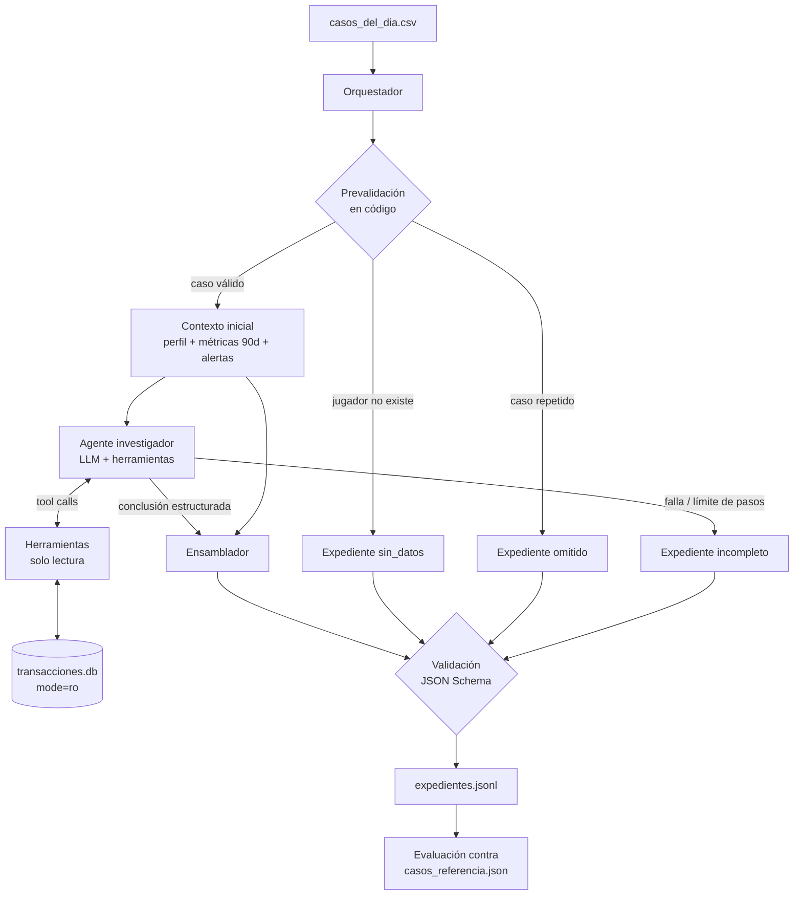

# Arquitectura del prototipo

> **Estado:** diseño inicial (2026-11-18), antes de escribir el código. Se actualiza a medida que se construye. La arquitectura **multiagente** de la Parte 2 es un entregable aparte; este documento describe el prototipo de la Parte 3.

## 1. La idea en una frase

**El código hace todo lo que se puede calcular; el LLM hace solo lo que requiere criterio.** El código valida el caso, calcula las métricas, busca cuentas relacionadas y arma el expediente. El LLM investiga con herramientas de solo lectura, interpreta las señales y redacta los hallazgos, el nivel de preocupación y el resumen.

Es el mismo principio del proyecto personal (D-001 allá, [D-001](decisiones.md#d-001) aquí): las cifras correctas no dependen del modelo.

## 2. Flujo de un caso

## 3. Los componentes

Cada componente explica **qué es**, **para qué sirve** y **cómo se usa aquí**.

### 3.1 Orquestador

- **Qué es.** El programa principal: un bucle sobre los casos del CSV. No es un LLM; es código determinista.
- **Para qué sirve.** Decide qué se investiga, en qué orden y qué pasa si algo falla. Es el "paso de orquestación" que pide la Parte 3.
- **Cómo se usa aquí.**
  - Lee el CSV y pasa cada caso por la prevalidación.
  - Llama al agente solo con los casos válidos.
  - Si el agente falla en un caso (error del proveedor, se acaba el límite de pasos, respuesta que no se puede leer), ese caso queda `incompleto` con el motivo en `alertas_calidad_datos`, y el resto sigue. **Un caso malo no tumba la corrida.**
  - Escribe una línea por caso, **en el mismo orden del CSV**, aunque el caso sea `sin_datos` u `omitido`: el revisor automático espera una línea por caso.

### 3.2 Prevalidación

- **Qué es.** Reglas en código que revisan el caso antes de gastar tokens.
- **Para qué sirve.** Las trampas que tienen una respuesta exacta no deben depender de que el modelo las note.
- **Cómo se usa aquí.**

  | Regla | Resultado |
  |---|---|
  | El jugador no está en `jugadores` | `sin_datos`, métricas `null` |
  | El par (`jugador_id`, `fecha_corte`) ya apareció en un caso anterior | `omitido`, con referencia al caso original |
  | El score del CSV no coincide con `scores_riesgo` | Se investiga, con alerta |
  | Hay jugadores con score ≥ el mínimo del CSV que no están en el CSV | Alerta en los casos relacionados con ellos |

### 3.3 Capa de datos

- **Qué es.** El código que habla con SQLite, en dos piezas, como el servidor MCP del proyecto personal:
  - **Reglas** (`rules`): funciones puras, sin base de datos (ventana de 90 días, conversión a USD, redondeo, fórmula del GGR). Se prueban en milisegundos.
  - **Repositorio** (`repository`): las consultas SQL. Solo traen filas y usan las reglas.
- **Para qué sirve.** Que las cifras sean exactas, estén probadas y no se repitan en varios lugares.
- **Cómo se usa aquí.**
  - La conexión se abre en **solo lectura** (`file:...?mode=ro`): aunque una consulta intentara escribir, SQLite la rechaza. Es la primera línea del "los agentes solo leen datos".
  - **Toda** consulta recibe la fecha de corte y filtra con ella (no hay forma de pedir datos sin corte).
  - Las consultas usan parámetros (`?`), nunca texto concatenado: no hay inyección SQL.
  - Las primeras pruebas: reproducir las métricas de los 5 casos de referencia al centavo.

### 3.4 Herramientas del agente

- **Qué es.** Funciones que el LLM puede pedir que se ejecuten (*tool calling*). El modelo no ejecuta nada: devuelve "quiero llamar a `resumen_apuestas` con estos argumentos", el código la ejecuta y le devuelve el resultado.
- **Para qué sirve.** Que el agente busque la evidencia que necesita según el caso, en lugar de recibir todo de golpe.
- **Cómo se usa aquí.** Herramientas propuestas (los nombres finales pueden cambiar al construir):

  | Herramienta | Devuelve | Por qué así |
  |---|---|---|
  | `resumen_transacciones` | Totales por tipo, estado y medio de pago; serie mensual; notas distintas, delimitadas como texto de terceros | Las notas son donde está la inyección (T3) |
  | `resumen_apuestas` | Por producto y juego: cantidad, monto, cuota media, uso de bono; distribución por hora; días activos; máximo por día | Agregado: el caso 025 tiene 49.196 apuestas (T4) |
  | `bonos` | Los bonos de la ventana con tipo, monto, fecha y estado | Son pocos por jugador |
  | `cuentas_relacionadas` | Cuentas que comparten `device_id`, con registro, score y si están en el CSV; cuántos jugadores comparten su `ip_red` | `device_id` es fuerte; `ip_red` se informa como débil (T6). Detecta a los que faltan (T9) |
  | `detalle_transacciones` | Una muestra acotada de transacciones (máximo N), filtrable por tipo y estado | Para ver la secuencia de un patrón (depósito → bono → retiro) |

  Reglas para todas las herramientas: solo lectura, siempre filtradas por el corte, sin datos personales, con salida de tamaño acotado y con errores legibles (si el modelo pide algo inválido, recibe un mensaje que le permite corregir la llamada).

### 3.5 Agente investigador

- **Qué es.** Un LLM en un **bucle de herramientas**: recibe el system prompt (Parte 1) y el contexto del caso, pide herramientas, lee los resultados y repite hasta concluir.
- **Para qué sirve.** Es la parte que reemplaza el criterio del analista: decidir qué mirar, conectar las señales y explicar.
- **Cómo se usa aquí.**
  - Recibe de entrada lo que ya calculó el código: perfil (sin datos personales), score y factores de los dos cortes, las métricas de 90 días y las alertas de la prevalidación. Así no gasta llamadas en lo obvio.
  - Tiene un **límite de pasos** (por ejemplo, 8 llamadas a herramientas). Si lo alcanza sin concluir, el caso queda `incompleto`.
  - Termina con una **salida estructurada** que solo contiene lo que le toca: `hallazgos`, `nivel_preocupacion`, `derivar_a`, `resumen`, `cuentas_relacionadas` confirmadas y alertas adicionales.

### 3.6 Ensamblador y validación

- **Qué es.** El código que une lo calculado con lo que concluyó el agente, y lo revisa contra `esquema_expediente.json` con la librería `jsonschema`.
- **Para qué sirve.** El revisor de la prueba valida cada línea automáticamente: un campo de más, un enum mal escrito o un resumen de 801 caracteres rompen la entrega.
- **Cómo se usa aquí.**
  - Las métricas, los ids y el estado los pone el código; el LLM **no puede** sobrescribirlos.
  - Si el resumen pasa de 800 caracteres, se recorta en el último punto y se deja una alerta (no se pide otra respuesta al modelo, para no gastar).
  - Una línea que no valida no se escribe tal cual: se marca `incompleto` con el error.

### 3.7 Cliente del LLM

- **Qué es.** El adaptador al proveedor. Se reutiliza el del proyecto personal: SDK `openai` apuntando a la API compatible de **Groq**.
- **Para qué sirve.** Un solo lugar para el modelo, las claves, los reintentos y el costo.
- **Cómo se usa aquí.**
  - Modelo `openai/gpt-oss-120b` en Groq ([D-008](decisiones.md#d-008)).
  - Cada llamada registra tokens, latencia y costo. Un modelo sin precio conocido tiene costo `None`, nunca 0.
  - Reintentos con espera ante el error 429 (límite de tasa del plan gratuito).
  - **LLM simulado**: una implementación con reglas fijas que no llama a la red. Sirve para las pruebas y para que el revisor pueda correr todo sin clave de API.

### 3.8 Evaluación

- **Qué es.** Un script que compara los expedientes generados con los 5 de `casos_referencia.json`.
- **Para qué sirve.** Responder "¿qué tan cerca estás?" con cifras y explicar las diferencias.
- **Cómo se usa aquí.** Métricas propuestas:

  | Qué se compara | Cómo |
  |---|---|
  | `estado_investigacion`, `nivel_preocupacion`, `derivar_a` | Acierto exacto |
  | `metricas_90d_usd` | Error absoluto por campo (debe ser 0: las calcula el código) |
  | `cuentas_relacionadas` | Precisión y exhaustividad contra la lista del analista |
  | `hallazgos` y `resumen` | Si mencionan los hechos clave del analista; opcionalmente, similitud con embeddings ([D-007](decisiones.md#d-007)) |
  | Validez del esquema | Las 25 líneas deben validar |
  | Costo y latencia | Por caso y por corrida |

  Como el LLM no es determinista, se corre **3 veces** y se reporta el rango, igual que en el proyecto personal. Los 5 casos de referencia son pocos: se complementan con las hipótesis de [02_datos.md](02_datos.md#6-perfil-de-cada-caso) para los otros 20, marcadas como "nuestra lectura", no como verdad.

### 3.9 Trazabilidad

- **Qué es.** El registro de lo que hizo el agente en cada caso.
- **Para qué sirve.** Poder responder "¿por qué el agente dijo esto?" y auditar que no leyó lo que no debía.
- **Cómo se usa aquí.** Un archivo de trazas por corrida con, por caso: herramientas llamadas y sus argumentos, tamaño de cada resultado, tokens, costo, latencia y errores. Langfuse (que ya se usa en el proyecto personal) queda como opción, no como requisito, para que el prototipo corra con pocos comandos.

## 4. Tecnologías

| Pieza | Elección | Por qué |
|---|---|---|
| Lenguaje | Python 3.12 | El del proyecto personal |
| Entorno | `uv` | `uv sync` reconstruye el entorno exacto con un comando |
| Base de datos | `sqlite3` de la librería estándar | La base ya viene en SQLite; no hace falta Docker ni Postgres |
| LLM | SDK `openai` contra Groq | Reutilizado del proyecto personal ([D-008](decisiones.md#d-008)) |
| Validación | `jsonschema` | Valida contra el esquema oficial (draft 2020-12) |
| Pruebas | `pytest` + `ruff` | TDD para la lógica determinista; LLM simulado para el agente |
| Bucle del agente | Propio, sin framework | [D-009](decisiones.md#d-009) |

## 5. Decisiones abiertas

- ~~Bucle propio o LangGraph~~: resuelto, bucle propio ([D-009](decisiones.md#d-009)).
- **Nombre y forma final de las herramientas**: se ajustan al escribir el prompt (Parte 1) y al ver qué pide el modelo en la práctica.
