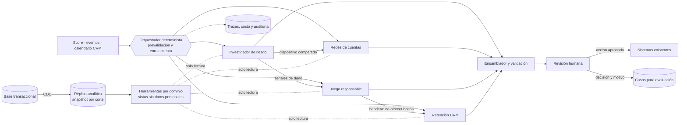

# Parte 2 · Arquitectura multiagente

**Idea central.** Agentes especialistas, de solo lectura, sobre una capa de datos gobernada. El código orquesta y calcula, el modelo aporta el juicio y una persona decide. Extiende el prototipo de la Parte 3: lo marcado *(probado)* ya funciona allí.

## Agentes, herramientas y permisos

| Agente | Qué hace | Herramientas (solo lectura) | Puede ver | No puede |
|---|---|---|---|---|
| **Investigador de riesgo** *(probado)* | Abuso de bonos, fraude de pago, dinero sin juego | Resúmenes de transacciones, apuestas y bonos; detalle acotado | Jugador del caso y cuentas que aparecen por evidencia | Ver datos personales o datos posteriores al corte; SQL libre; actuar sobre la cuenta |
| **Redes de cuentas** | Delimitar grupos de cuentas de una misma persona | Vecinos por dispositivo y por medio de pago (hash); comunidades precalculadas cada noche | Identificadores con hash y fechas | Ver montos individuales, notas o datos personales |
| **Juego responsable** | Señales de daño: volumen extremo, madrugada, persecución de pérdidas | Series por sesión y por día; límites y autoexclusiones; contactos previos | Límites y autoexclusión (solo este agente) | Ver marketing; contactar al jugador |
| **Retención CRM** | Proponer acciones de retención | Valor del cliente; campañas y su respuesta | Solo la bandera "no ofrecer bonos", sin detalle | Ver investigaciones; enviar campañas |

**Acceso a datos altamente transaccionales.**
- Ningún agente toca la base transaccional. Se lee una réplica alimentada por CDC, con un **snapshot por fecha de corte**: la investigación es reproducible y no carga la operación.
- Cada agente tiene su identidad de servicio y su servidor de herramientas (MCP). Los permisos se aplican en vistas:
  - por columna, con los datos personales reemplazados por tokens;
  - por fila, limitadas al jugador y a las cuentas descubiertas por evidencia *(probado)*.
- Las herramientas devuelven agregados con tope y tienen tiempo máximo por consulta *(probado: 49.196 apuestas en menos de 3.000 caracteres)*.
- No hay herramientas de escritura. El texto libre llega marcado como dato de terceros *(probado: la inyección del caso 011 no se obedece)*.

## Orquestación

- **Un orquestador determinista, no un LLM supervisor.**
  - Prevalida en código: jugador inexistente, caso duplicado, score que no cuadra *(probado)*.
  - Enruta por tipo de disparador.
  - Abre subcasos por evidencia: un dispositivo compartido va a Redes de cuentas; las señales de daño, a Juego responsable.
  - **Por qué determinista:** costo y rutas predecibles y auditables. El criterio del LLM se usa dentro de cada agente.
- **Precedencia:** juego responsable y riesgo prevalecen sobre CRM. Un jugador con bandera no recibe bonos, sin importar lo que proponga CRM.
- **Motor:** un flujo durable (LangGraph con checkpoints, o Temporal) para pausar en la revisión humana y reanudar sin repetir pasos. Para un lote diario basta el bucle propio del prototipo.

## Estado, fallas, revisión humana, trazabilidad y costo

- **Estado.**
  - Máquina de estados por caso (`nuevo → prevalidado → investigando → en_revisión → cerrado`) guardada en una base.
  - Clave de idempotencia `(jugador, fecha_corte, agente)` *(probado: los duplicados se omiten)*.
  - Checkpoint de cada paso del agente.
  - Sin memoria libre entre casos: el historial de decisiones humanas se consulta como una herramienta más.
- **Fallas.**
  - Reintentos con espera ante límites de tasa *(probado)*, modelo alternativo y *circuit breaker*.
  - Límites de pasos y de tokens: si se agotan, el caso queda `incompleto` para un humano y el lote sigue *(probado)*.
  - Salida validada con esquema antes de escribir *(probado)*.
  - Modo degradado con reglas fijas si no hay LLM *(probado)*.
- **Revisión humana.**
  - Los agentes recomiendan; toda acción la aprueba una persona en una bandeja priorizada por nivel.
  - Los casos de nivel alto y los de juego responsable se revisan siempre; de los de nivel bajo se revisa una muestra, para medir falsos negativos.
  - Cada decisión, con su motivo, alimenta la evaluación.
- **Trazabilidad.**
  - Por caso: versión de prompt y de modelo, snapshot de datos, cada herramienta con sus argumentos y su resultado, tokens, costo, latencia, reintentos *(probado)*, y quién aprobó qué.
  - En producción: OpenTelemetry o Langfuse.
- **Costo.**
  - El código calcula las métricas y las referencias (percentiles).
  - Las herramientas que se usan siempre se precargan *(probado: en el caso 011, de 4–6 pasos se pasó a 2)*.
  - Router sin LLM.
  - Un modelo pequeño para triage y resúmenes; uno grande para investigar.
  - Lotes con descuento para lo no urgente, y presupuesto por caso y por día con alertas.
  - En el prototipo: 0,0023–0,0029 USD por caso investigado, unos 0,06 USD por lote de 23 casos con `openai/gpt-oss-120b` ([reporte](../evaluacion/reporte.md)).
- **Calidad continua.** Antes de cambiar un prompt o un modelo, cada agente se evalúa contra los casos revisados por humanos y contra una línea base de reglas, con varias corridas *(probado)*.
